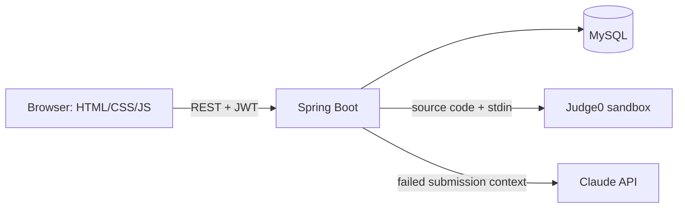
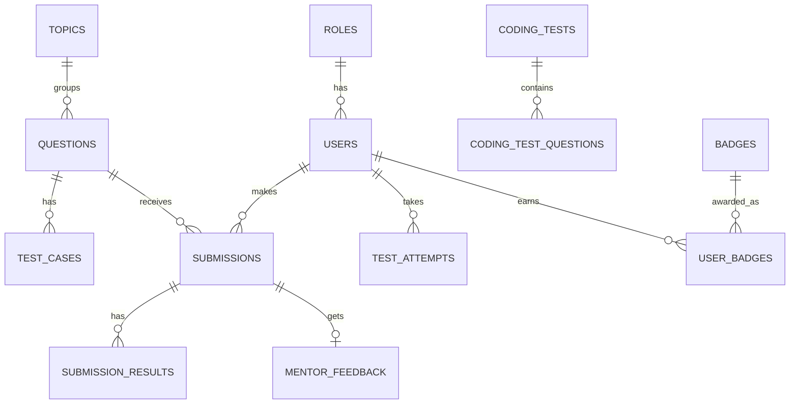

# CodeForge

A placement-oriented coding practice and assessment platform. Students solve DSA problems in the browser, take timed tests, track progress, and get AI-powered hints when they get stuck.

## Features
- Register/login with BCrypt-hashed passwords and JWT authentication
- Question bank with topics, difficulty levels, sample and hidden test cases
- In-browser Java editor with **Run** (sample tests) and **Submit** (all tests, including hidden)
- Sandboxed code execution via Judge0 (user code never runs on the app server)
- AI Mentor (Claude API): structured hints, concepts to revise, complexity feedback, no full solution unless requested
- Dashboard: attempted/solved, accuracy, streak, topic and difficulty progress
- Placement Arena: timed tests with server-side expiry checks and scoring
- XP, badges, and leaderboard
- Admin panel for managing questions and test cases (role-protected)

## Tech stack
Java 21, Spring Boot 4, Spring Security, Spring Data JPA (Hibernate), MySQL 9, Judge0, Anthropic Claude API, plain HTML/CSS/JavaScript.

## Architecture

Layers: Controller → Service → Repository → Entity, with DTOs at the API boundary.

## Database (simplified ER)

## Security highlights
- Passwords hashed with BCrypt; JWT signed with a secret from an environment variable
- Role read from the database on each request, not trusted from the token
- Hidden test cases never leave the server
- Admin routes restricted with `hasRole("ADMIN")`; submissions scoped to their owner
- Secrets (DB password, JWT secret, API keys) come only from environment variables
- Parameterized queries via JPA; input validated with Bean Validation

## Run locally
1. Install JDK 21 and MySQL; create database `codeforge` and a limited user.
2. Set environment variables: `DB_PASSWORD`, `JWT_SECRET` (Base64, 48+ bytes), optional `CLAUDE_API_KEY`.
3. From `backend/`: `./mvnw spring-boot:run`
4. Open http://localhost:8080

## Known limitations
- The Arena page opens problems in a new tab; submissions there are not yet linked to the attempt (the linked endpoint exists and is tested via API)
- Java only; more languages are a data change plus Judge0 language ids
- Uses the public Judge0 instance for development